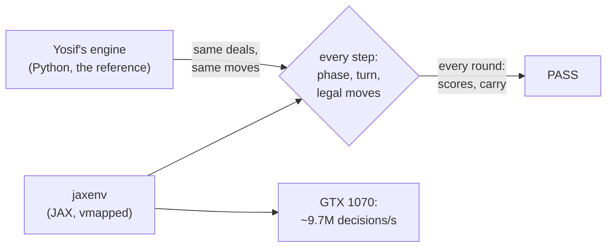

# Estimation rules in JAX

The bitter-lesson track starts here: the whole game on the GPU, so self-play can scale with
compute instead of hand-made features, rules and search.



| Piece | File | Mirrors |
|---|---|---|
| One round: state, legal moves, step, scoring | `jaxenv/rules.py` | `estimation.engine.round`, `scoring` |
| A full game: carry, fixed trumps, replays | `jaxenv/game.py` | `estimation.engine.bola` |
| Move-by-move comparison | `jaxenv/check.py`, `tests/test_jaxenv.py` | |
| Throughput | `jaxenv/bench.py` | |

```bash
UV_PROJECT_ENVIRONMENT=.venv-jax uv sync --group jax
.venv-jax/bin/python -m jaxenv.check --rounds 100000 --games 1000
.venv-jax/bin/python -m jaxenv.bench
```

## Verified identical (3 November 2026)

The check plays the same deals in both implementations, choosing each move from the engine's
legal list. It requires the same phase, the same player to act and the same full set of legal
moves at every step. It also requires the same scores, next carry, skip flag and trump change
for every round, and the same final scores for every game.

| Run | Steps compared | Result |
|---|---|---|
| 100,000 rounds: open and fixed-trump, random carries and scores | ~5.8 M | identical |
| 1,000 full games through `Bola` | ~1.8 M | identical |
| 10 scripted auctions from the engine's AUC-3 to AUC-6 and L1 to L10 tests, × 20 play-outs | ~12,700 | identical |

Moves mix uniform random play (reaches rare rules), an auction-heavy policy (Dash Calls,
Withs, stays) and HeuristicBot play (realistic games). How often the rare rules fired in the
100,000-round run:

| Rule | Times |
|---|---|
| super call (FIX-4) | 28,205 |
| answering a raise (AUC-3) | 11,746 |
| lone bidder (AUC-5) | 8,332 |
| skipped rounds, incl. 1,915 with four Dash Calls | 7,845 |
| an answer barred by the 13 rule (AUC-6) | 45 |
| exploding-doubles games flagged | 99 of 1,000 |

The top bidder's final keep or raise barred by AUC-6 never occurred, in this run or in
923,000 engine-only random auctions. In the engine's own tests every such case uses
non-default rule switches.

## Limits

- **Default rules only** (`RulesConfig()`); the switches are constants in `rules.py`.
- **int32 scores.** The engine's scores are unbounded. When all four seats keep failing, the
  doubling carry can leave int32's range. `Game.overflow` flags such a game (carry above
  2^20 or a score past 2^30). The check verifies that the flag rises exactly when the engine's
  numbers leave that range. Training should drop flagged games.
- **Deals** come from JAX keys, not the engine's numpy deal. `advance` takes hands, so tests
  feed the engine's deals.

## Speed (GTX 1070, random legal play)

| | Decisions per second |
|---|---|
| Yosif's engine, one CPU core | ~285,000 |
| our old training loop (features + nets) | ~6,500 |
| **jaxenv, 16,384+ games at once** | **~9.7 M** |

Two GPU lessons: deal from a pre-shuffled pool, because a deal is needed only every ~65 moves
and shuffling is the costly part. And never `sort` tiny rows: XLA's GPU sort of many 3-element
rows was 150x slower past 8,192 games, so `_sort3` ranks by counting instead.

## Statistics: JAX vs the CPU engine

`jaxenv.stats` plays full games of uniform random play on independent deals in each
implementation and compares the distributions (12,000 CPU games, 639,000 GPU games). Games past
int32's range are dropped on both sides. All 16 stats agree within noise; the largest
difference is |z| = 1.47. Random play describes the rules, not sensible games: 84% of rounds
have everyone lose, and nearly every game hits the 20-replay cap.

| Stat | CPU engine | JAX | z |
|---|---|---|---|
| rounds skipped | 2.33% | 2.31% | -0.81 |
| four Dash Calls | 2.14% | 2.12% | -0.98 |
| Dash Calls per round | 0.686 | 0.685 | -0.50 |
| rounds with a super call | 64.52% | 64.50% | -0.33 |
| fixed trump changed | 59.05% | 59.02% | -0.36 |
| everyone lost the round | 84.35% | 84.40% | +0.68 |
| doubled by 3+ calls | 31.78% | 31.67% | -1.47 |
| With players per round | 1.082 | 1.080 | -1.33 |
| Caller made the call | 0.12% | 0.11% | -1.14 |
| Risks per round | 9.306 | 9.306 | +0.00 |
| rounds per game | 37.93 | 37.92 | -0.30 |
| decisions per game | 2,305 | 2,305 | +0.54 |
| fixed replays per game | 19.93 | 19.92 | -0.30 |
| winner's score, mean | 10.7M | 10.3M | -1.12 |
| score spread, mean | 21.6M | 20.8M | -1.19 |
| games past int32 range | 20.6% | 20.6% | -0.21 |

Throughput in that run: 0.8M decisions/s on all 6 CPU cores, 8.7M/s on the GTX 1070.

## Self-play

`jaxenv.selfplay` trains one policy for every decision from raw state (`jaxenv.encode`, 747
inputs). `jaxenv.check` requires the GPU encoder to equal `jaxenv.encode_np`, the numpy version an
arena bot plays through, at every step, so the policy sees only what a seat may see.

| Piece | Choice |
|---|---|
| Algorithm | PPO, clipped at 0.2 |
| Reward | At the Bola's end by position: King +1, Sub-King +0.2, Sub-Kooz -0.2, Kooz -1, ties shared |
| Credit | TD(lambda = 0.95) along each seat's own decisions |
| Critic | Training only: the same view plus the three hidden hands, so deal luck stays out of the advantage |
| Extra head | Predicts the round's relative score, to teach the policy's shared layers |
| Opponents | Half self-play; in the rest two seats play a past version |

The 2.4M-parameter first version trained at about 75,000 decisions/s on a per-round reward and
stalled (6-54 against Heuristic at iteration 400). The current 384x3 nets run near 150,000/s.
Real strength is judged in the arena, by position against Heuristic, then PIMC and RL v2.

## Watching a run

The live site's `/lab` shows a run as it trains. `jaxenv.lab_capture` films each
saved version: the same fixed hand and lead asked of every version, one game against Heuristic on
fixed deals, replayed through the JAX rules as a live check, and six quick games. The page's reel
scrubs or plays through versions, so you can watch its opinion form.

```bash
JAX_PLATFORMS=cpu .venv-jax/bin/python -m jaxenv.lab_capture runs/run2
```
