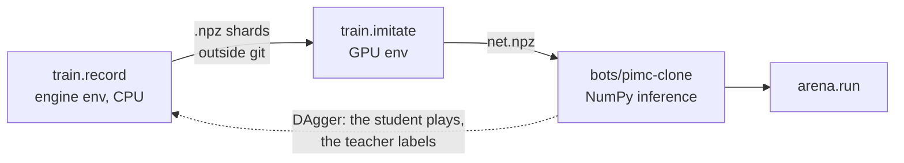

# train/

Imitation learning for rung 2. Recording and rating use the engine's environment; training uses
a separate one, because the home server's GTX 1070 needs PyTorch 2.8 and the engine needs 2.14+.



```bash
# GPU environment (once)
uv venv .venv-gpu --python 3.12
uv pip install --python .venv-gpu/bin/python torch==2.8.0 --index-url https://download.pytorch.org/whl/cu126
uv pip install --python .venv-gpu/bin/python numpy

# record, train, rate
uv run python -m train.record --teacher pimc:samples=100 --games 800 --workers 4 --out ~/workspace/estimation-data/rung2/pimc100
.venv-gpu/bin/python -m train.imitate --data ~/workspace/estimation-data/rung2/pimc100 --out bots/pimc-clone/net.npz
uv run python -m arena.sweep --bot pimc-clone --vs pimc --sets 200 --seed 1000 --workers 5 --grid net=net.npz
```
